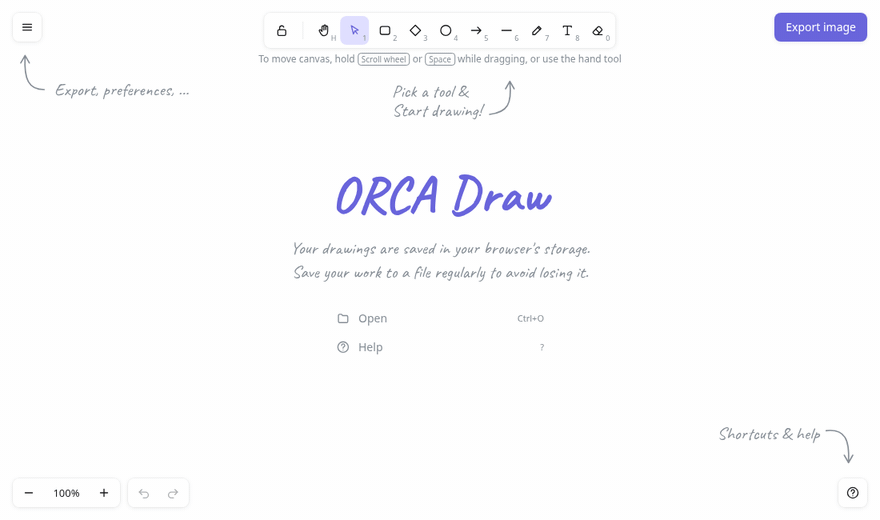

<div align="center">

# ORCA Draw

**A hand-drawn style whiteboard that runs in your browser — an Excalidraw-compatible clone built with Vite + rough.js.**

[**▶ Try it now (no install)**](https://nazmul87-wq.github.io/orca-draw/) · [One-line install](#-one-line-install) · [Shortcuts](#%EF%B8%8F-keyboard-shortcuts)



</div>

## ✨ Features

- **Sketchy shapes** — rectangle, diamond, ellipse, arrow, line, freehand pencil, text and eraser, all rendered with [rough.js](https://roughjs.com/)
- **Styling panel** — stroke & background colors, fill style (hachure / cross-hatch / solid), stroke width & style, sloppiness, rounded edges, opacity, arrowheads, font size/family/alignment
- **Infinite canvas** — pan (hand tool, Space + drag, wheel) and zoom (Ctrl + wheel, zoom-to-fit)
- **Editing** — select, multi-select, move, resize, rotate, duplicate, copy/paste, layer ordering, unlimited undo/redo
- **Export** — PNG and SVG; save/open `.excalidraw` files
- **Excalidraw compatible** — same `.excalidraw` v2 file format, same localStorage keys, paste from Excalidraw's clipboard
- **Dark mode** — Catppuccin Mocha themed (`Alt + Shift + D`)
- **Auto-save** — your drawing persists in browser storage between sessions
- **Tiny & dependency-light** — vanilla JS, ~25 KB gzipped

## 🚀 One-line install

**Easiest:** just open **https://nazmul87-wq.github.io/orca-draw/** — nothing to install.

**Run it locally** (Linux / macOS, needs `git` and Node.js 18+):

```bash
wget -qO- https://raw.githubusercontent.com/nazmul87-wq/orca-draw/main/install.sh | bash
```

or with curl:

```bash
curl -fsSL https://raw.githubusercontent.com/nazmul87-wq/orca-draw/main/install.sh | bash
```

The installer:

1. clones the app to `~/.local/share/orca-draw` (override with `ORCA_DIR=...`)
2. installs dependencies and builds it
3. creates an `orca-draw` command in `~/.local/bin`
4. on Linux, adds **ORCA Draw** to your applications menu

Then launch it from your app menu, or run:

```bash
orca-draw          # serves on http://localhost:5179 and opens your browser
```

Re-run the same install command any time to update. Use `ORCA_PORT=8080` to change the port.

### Uninstall

```bash
rm -rf ~/.local/share/orca-draw ~/.local/bin/orca-draw ~/.local/share/applications/orca-draw.desktop
```

## 🛠️ Development

```bash
git clone https://github.com/nazmul87-wq/orca-draw.git
cd orca-draw
npm install
npm run dev        # dev server with hot reload
npm run build      # production build → dist/
npm run preview    # serve the production build
```

Every push to `main` is automatically deployed to GitHub Pages by [`.github/workflows/pages.yml`](.github/workflows/pages.yml).

### Project layout

```
index.html      UI shell: toolbar, menus, panels, dialogs
src/main.js     canvas engine: tools, selection, history, rendering, import/export
src/icons.js    inline SVG icon set
src/style.css   light theme + Catppuccin Mocha dark theme
install.sh      one-line installer
```

## ⌨️ Keyboard shortcuts

| Tool | Key | | Action | Key |
|---|---|---|---|---|
| Hand (pan) | `H` | | Undo / Redo | `Ctrl+Z` / `Ctrl+Shift+Z` |
| Selection | `V` / `1` | | Select all | `Ctrl+A` |
| Rectangle | `R` / `2` | | Copy / Cut / Paste | `Ctrl+C` / `X` / `V` |
| Diamond | `D` / `3` | | Duplicate | `Ctrl+D` or `Alt`+drag |
| Ellipse | `O` / `4` | | Delete | `Delete` |
| Arrow | `A` / `5` | | Bring forward / to front | `Ctrl+]` / `Ctrl+Shift+]` |
| Line | `L` / `6` | | Send backward / to back | `Ctrl+[` / `Ctrl+Shift+[` |
| Draw | `P` / `7` | | Zoom to fit | `Shift+1` |
| Text | `T` / `8` | | Save / Open | `Ctrl+S` / `Ctrl+O` |
| Eraser | `E` / `0` | | Export PNG | `Ctrl+Shift+E` |
| Keep tool active | `Q` | | Help | `?` |

## 🗺️ Not yet implemented

Text bound inside shapes, arrow binding, groups, images/frames, live collaboration, shape library, multi-element resize.

## 🙏 Credits

Inspired by [Excalidraw](https://excalidraw.com). Rendering by [rough.js](https://github.com/rough-stuff/rough). Handwriting font: [Caveat](https://fonts.google.com/specimen/Caveat).
